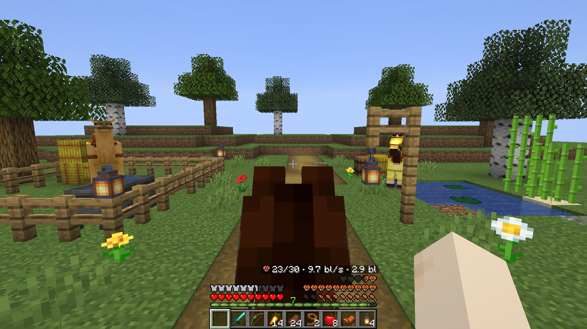
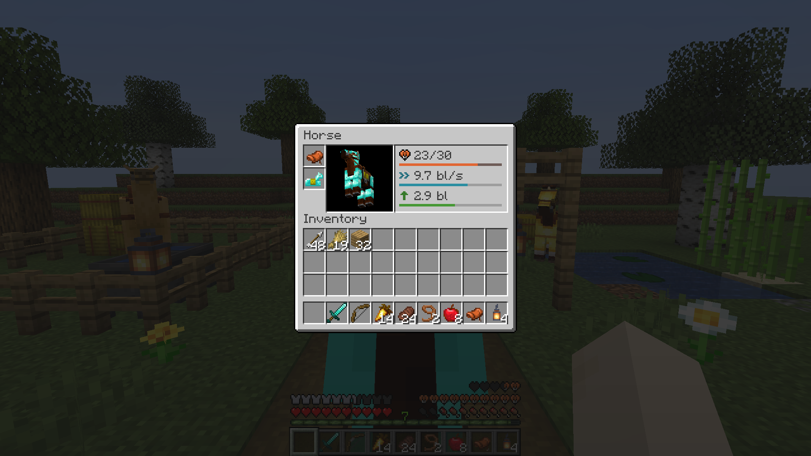

# Mount HUD

**Hunger and your horse's health at the same time, and the experience bar that turns into the jump bar only while you jump.**
A client-side riding HUD for Forge, NeoForge and Fabric.

**English** · [Русский](README.ru.md)

## What it does

When you ride a horse, pig, camel, strider or any other living mount, vanilla Minecraft hides two things:

- your **hunger bar** (the mount's hearts take its place), and
- your **experience bar** (the jump bar takes its place, even when you are not jumping).

Mount HUD keeps both:

- **Hunger and the mount's hearts at once.** The mount's hearts go one row above hunger (the air bubbles move up above them), or to the left above your armor, as you choose.
- **Experience while riding.** The experience bar and level stay visible and turn into the jump bar only while you charge a jump (and while a camel's dash recharges). You can also keep the jump bar all the time, as in vanilla, or never show it.
- **Mount stats.** Your mount's health, speed in blocks per second and jump height in blocks are shown with rating bars in the horse inventory screen and, if you turn them on, above the mount's hearts on the HUD while riding.

The mod only changes your HUD: it is not needed on the server, and works on any server.

## Versions and files

Three files cover every supported loader and Minecraft version:

| File | Loader | Minecraft versions | Notes |
|---|---|---|---|
| `mount-hud-fabric-<version>+mc1.16.5-26.3.jar` | Fabric, Quilt | 1.16.5 – 1.21.11, 26.1 – 26.3 | Fabric API is not required; [Mod Menu](https://www.curseforge.com/minecraft/mc-mods/modmenu) is optional for the settings screen |
| `mount-hud-forge-<version>+mc1.17.1-1.20.1.jar` | Forge, NeoForge 1.20.1 | 1.17.1 – 1.20.1 | — |
| `mount-hud-neoforge-<version>+mc1.20.5-26.3.jar` | NeoForge | 1.20.5 – 1.21.11, 26.1 – 26.3 | — |

## Compatibility

- **AppleSkin** — saturation, hunger exhaustion and food restoration previews are drawn on the hunger bar while riding on Fabric, Forge and NeoForge.
- **Raised** — the mount's hearts, hunger bar, experience/jump bar and HUD stats follow the HUD offset automatically.

## Settings

`config/mounthud.properties`, also changed on the settings screen: through Mod Menu on Fabric, the Config button in the Mods list on Forge and NeoForge.

| Setting | Values | Default | What it does |
|---|---|---|---|
| `enabled` | `true` / `false` | `true` | Everything the mod changes; `false` gives the vanilla HUD |
| `hunger_while_riding` | `true` / `false` | `true` | Keep the hunger bar while riding a mount with health |
| `hearts_position` | `above_hunger` / `left` | `above_hunger` | Where the mount's hearts go while hunger is shown |
| `jump_bar` | `auto` / `always_jump` / `always_experience` | `auto` | `auto`: experience, the jump bar while charging; `always_jump`: as in vanilla; `always_experience`: never the jump bar |
| `mount_stats` | `inventory` / `hud_and_inventory` / `off` | `inventory` | Where the mount's speed, jump height and health are shown |

## Languages

English, Russian, Ukrainian, German, Spanish, Portuguese (Brazil), Chinese (Simplified), French, Italian, Polish, Japanese, Korean, Turkish.

## License

[MIT](LICENSE).
