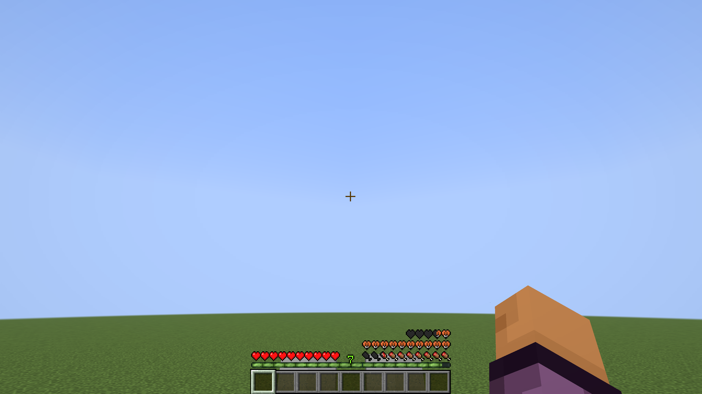
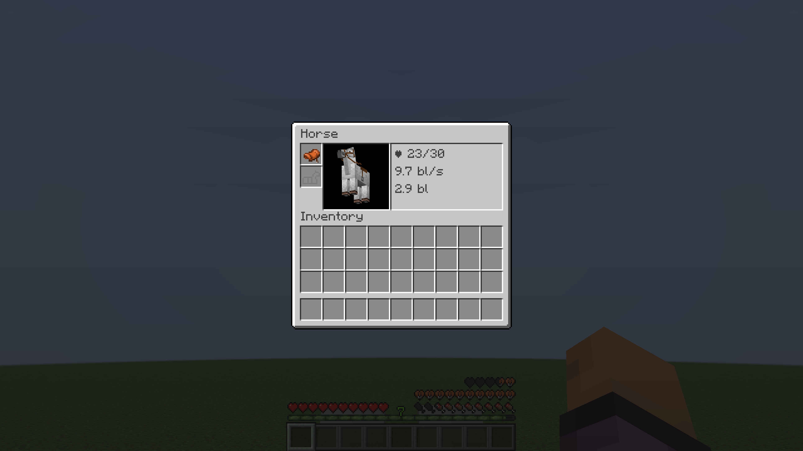

# Mount HUD

**Голод и здоровье лошади одновременно, а полоска опыта сменяется полоской прыжка, только пока прыгаешь.**
Клиентский HUD для езды верхом на Forge, NeoForge и Fabric.

[English](README.md) · **Русский**

## Что делает мод

Когда вы едете на лошади, свинье, верблюде, страйдере или другом живом животном, ванильный Minecraft прячет две вещи:

- **полоску голода** (на её месте сердца животного) и
- **полоску опыта** (на её месте полоска прыжка, даже когда вы не прыгаете).

Mount HUD оставляет обе:

- **Голод и сердца животного одновременно.** Сердца животного рисуются на ряд выше голода (пузырьки воздуха поднимаются над ними) или слева над бронёй — как выберете.
- **Опыт верхом.** Полоска опыта и уровень остаются видны и сменяются полоской прыжка, только пока вы заряжаете прыжок (и пока у верблюда восстанавливается рывок). Можно оставить полоску прыжка всегда, как в ванили, или не показывать её никогда.
- **Характеристики животного.** Здоровье, скорость в блоках в секунду и высота прыжка в блоках показываются в экране инвентаря лошади и, если включить, над сердцами животного в HUD при езде.

Мод меняет только ваш интерфейс: на сервере он не нужен и работает на любом сервере.

## Версии и файлы

Три файла покрывают все поддерживаемые загрузчики и версии Minecraft:

| Файл | Загрузчик | Версии Minecraft | Примечания |
|---|---|---|---|
| `mount-hud-fabric-<версия>+mc1.16.5-26.3.jar` | Fabric, Quilt | 1.16.5 – 1.21.11, 26.1 – 26.3 | Fabric API не требуется; [Mod Menu](https://modrinth.com/mod/modmenu) необязателен (для экрана настроек) |
| `mount-hud-forge-<версия>+mc1.17.1-1.20.1.jar` | Forge, NeoForge 1.20.1 | 1.17.1 – 1.20.1 | — |
| `mount-hud-neoforge-<версия>+mc1.20.5-26.3.jar` | NeoForge | 1.20.5 – 1.21.11, 26.1 – 26.3 | — |

## Совместимость

- **AppleSkin** — насыщение, истощение и предпросмотр восстановления сытости от еды в руке рисуются на полоске голода при езде на Fabric, Forge и NeoForge.
- **Raised** — сердца животного, полоска голода, полоска опыта/прыжка и строка характеристик автоматически сдвигаются вместе с остальным HUD.

## Настройки

`config/mounthud.properties`; их же меняет экран настроек: через Mod Menu на Fabric, кнопкой «Настроить» в списке модов на Forge и NeoForge.

| Настройка | Значения | По умолчанию | Что делает |
|---|---|---|---|
| `enabled` | `true` / `false` | `true` | Всё, что меняет мод; `false` — ванильный интерфейс |
| `hunger_while_riding` | `true` / `false` | `true` | Показывать полоску голода верхом на животном со здоровьем |
| `hearts_position` | `above_hunger` / `left` | `above_hunger` | Где рисовать сердца животного, пока видна полоска голода |
| `jump_bar` | `auto` / `always_jump` / `always_experience` | `auto` | `auto`: опыт, полоска прыжка пока заряжаете; `always_jump`: как в ванили; `always_experience`: полоски прыжка нет никогда |
| `mount_stats` | `inventory` / `hud_and_inventory` / `off` | `inventory` | Где показывать скорость, высоту прыжка и здоровье животного |

## Языки

Английский, русский, украинский, немецкий, испанский, португальский (Бразилия), китайский (упрощённый), французский, итальянский, польский, японский, корейский, турецкий.

## Лицензия

[MIT](LICENSE).
