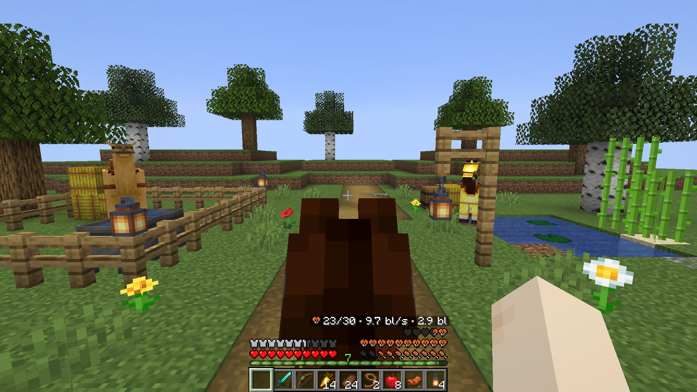

When you ride a horse, camel, pig or strider, Minecraft hides your hunger bar and replaces your experience bar with the jump bar. **Mount HUD** keeps both on screen.

- **Hunger and the mount's hearts at once:** the mount's hearts sit one row above your hunger bar (and your air bubbles move up above them), or on the left above your armor.
- **Experience while riding:** the experience bar and level stay visible and turn into the jump bar only while you charge a jump or wait for a camel's dash to recharge. You can also keep the jump bar all the time or never show it.
- **Mount stats:** your mount's health, speed in blocks per second and jump height in blocks are shown with rating bars in the horse inventory screen and, if you turn them on, above the mount's hearts on the HUD while riding.
- **Client-only and compatible:** works on any server without being installed there, and works out of the box with **AppleSkin** and **Raised**.
- **Settings screen with live preview:** preview every HUD layout directly in the settings screen through Mod Menu on Fabric, or with the Config button in the Mods list on Forge and NeoForge.

Three files cover everything: one for Fabric and Quilt (Minecraft 1.16.5 – 1.21.11 and 26.1 – 26.3, no Fabric API needed), one for Forge 1.17.1 – 1.20.1 (and NeoForge 1.20.1), and one for NeoForge 1.20.5 – 1.21.11 and 26.1 – 26.3.

[Source and details](https://github.com/Shamanalle/mount-hud) · [Bugs and ideas](https://github.com/Shamanalle/mount-hud/issues)

Русский

Когда вы едете на лошади, верблюде, свинье или страйдере, Minecraft прячет полоску голода и заменяет полоску опыта полоской прыжка. **Mount HUD** оставляет обе на экране.

- **Голод и сердца животного одновременно:** сердца животного располагаются на ряд выше голода (а пузырьки воздуха поднимаются над ними) или слева над бронёй.
- **Опыт верхом:** полоска опыта и уровень остаются видны и сменяются полоской прыжка, только пока вы заряжаете прыжок или ждёте перезарядки рывка верблюда. Можно также оставить полоску прыжка всегда или не показывать её никогда.
- **Характеристики животного:** здоровье, скорость в блоках в секунду и высота прыжка в блоках со шкалами показываются в инвентаре лошади и, если включить в настройках, над сердцами животного на HUD при езде.
- **Только на клиенте и совместимо:** работает на любом сервере без установки на сервер и сразу дружит с **AppleSkin** и **Raised**.
- **Экран настроек с живым предпросмотром:** проверяйте любую раскладку HUD прямо в окне настроек через Mod Menu на Fabric или кнопкой «Настроить» в списке модов на Forge и NeoForge.

Всего три файла: для Fabric и Quilt (Minecraft 1.16.5 – 1.21.11 и 26.1 – 26.3, Fabric API не нужен), для Forge 1.17.1 – 1.20.1 (и NeoForge 1.20.1) и для NeoForge 1.20.5 – 1.21.11 и 26.1 – 26.3.

[Исходники и подробности](https://github.com/Shamanalle/mount-hud) · [Ошибки и идеи](https://github.com/Shamanalle/mount-hud/issues)

